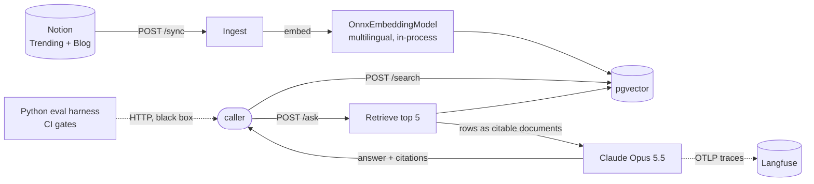

<div align="center">

# 📡 Radar RAG

[](https://github.com/zexion7873/radar-rag/actions/workflows/ci.yml)


**Ask the GitHub Radar archive a question, in Chinese or English, and get an answer grounded
in the weekly trending rows and the blog archive, with citations back to the rows it used.**

[](https://whyisthistrending.vercel.app/ask)
[](#-prerequisites)
[](#-results)
[](LICENSE)

<sub>The live page's first question after a quiet spell waits 10–15 s for a cold start.</sub>

No embedding API. No vector database service. No PyTorch. One JVM, one pgvector table, and a Python
harness that gates every pull request.

</div>

---

## 🌐 What it gives you

A Java / Spring Boot service over the [GitHub Radar](https://whyisthistrending.vercel.app) Notion
archive that a set of Claude Code routines writes every week
([case study](https://github.com/zexion7873/github-radar-ui/blob/main/docs/case-study.md)). It adds what
the read-mostly [`github-radar-ui`](https://github.com/zexion7873/github-radar-ui) cannot do:

- `POST /sync` — pull the Trending and Blog tables from Notion into pgvector, one row per Notion page.
- `POST /search` — semantic search, optionally filtered by source, category, language, week or stars.
- `POST /ask` — grounded Q&A: Claude answers from the top 5 rows and cites the ones it used, as JSON
  or as Server-Sent Events.

Request and response shapes, status codes and the stream's events are in [docs/api.md](docs/api.md);
the milestones (P0–P5) and their decisions in [docs/stack-plan.md](docs/stack-plan.md).

---

## 🧭 How it fits together



---

## 📋 Prerequisites

- Java 25 or newer (CI builds on Temurin 25)
- Docker (for the pgvector Postgres)
- The **Notion integration token** already shared into the archive tables

Embeddings run **locally in-process** (ONNX `paraphrase-multilingual-MiniLM-L12-v2`, 384-dim) — no
API key. `scripts/fetch-models.sh` downloads the model (~480 MB) once, at a pinned Hugging Face
revision with a sha256 check; the service will not start without it. Every external service the code
calls is listed in [docs/external-services.md](docs/external-services.md) (in Chinese).

---

## 🏃 Run it yourself

> [!NOTE]
> A clone runs without access to the Notion archive. Start the service with
> `NOTION_TOKEN=dummy NOTION_BASE_URL=http://127.0.0.1:8765`, and a retrieval eval
> ([evals/README.md](evals/README.md)) syncs the frozen fixtures from a local stub, as CI does.

```bash
scripts/fetch-models.sh             # the embedding model, once
docker compose up -d                # pgvector Postgres
export NOTION_TOKEN=ntn_...
export ANTHROPIC_API_KEY=sk-ant-... # /ask only
mvn spring-boot:run                 # creates the vector_store table on first boot

curl -X POST localhost:8080/sync
curl -X POST localhost:8080/search -H 'Content-Type: application/json' \
  -d '{"q":"agent frameworks","topK":5,"language":"Python","minStars":500}'
curl -X POST localhost:8080/ask -H 'Content-Type: application/json' \
  -d '{"q":"which trending repos are about agent skills, and what do they do?"}'
```

Swagger UI is at `/swagger-ui.html`. `docker compose --profile app up --build` runs the shipped image
instead ([docs/api.md](docs/api.md#in-a-container)).

The public deployment runs on Cloud Run under the `prod` profile: `/sync` behind a secret, per-client
rate limits, and a Turnstile check on `/ask` ([docs/api.md](docs/api.md#prod-profile)). `/search` also
answers curl:

```bash
curl -X POST https://radar-rag-50472171523.asia-east1.run.app/search \
  -H 'Content-Type: application/json' -d '{"q":"agent memory across sessions","topK":3}'
```

---

## 🛠️ Develop

```bash
mvn -B verify   # unit and slice tests, then the integration tests; no tokens
```

The integration tests start a pgvector container through Testcontainers, so `verify` needs a running
Docker; on macOS, Docker Desktop must expose its default socket, or set
`DOCKER_HOST=unix://$HOME/.docker/run/docker.sock`. [CONTRIBUTING.md](CONTRIBUTING.md) has the traps
worth knowing first; [AGENTS.md](AGENTS.md) has the rest.

CI also runs the Python eval harness in [`evals/`](evals/README.md): retrieval gates
that fail on any hit@5 flip against a committed baseline, and, on the owner's label, a paid LLM eval
(about $4.4 a run) judged by `claude-sonnet-5-5`.

---

## 🔭 Tracing (Langfuse)

With `LANGFUSE_PUBLIC_KEY` and `LANGFUSE_SECRET_KEY` set (and `LANGFUSE_BASE_URL` for a region other
than Japan), the service sends every request's spans to Langfuse over OTLP: the HTTP request, the
vector search, the chat client and the Claude call, with its prompt, answer, token usage and cost.
Without both keys nothing leaves the process. The public deployment sets neither key, so visitors'
questions are not traced ([PRIVACY.md](PRIVACY.md)).

---

## 📊 Results

From the CI runner, on the answerable items; every change's before and after is in
[docs/results.md](docs/results.md).

| Gate | Golden set | hit@5 | R@5 | MRR |
|---|---|---:|---:|---:|
| Retrieval, trending only | golden_v1 (62 items) | 0.857 | 0.579 | 0.669 |
| Retrieval, every source (what `/ask` reads) | golden_v1 | 0.762 | 0.454 | 0.536 |
| Retrieval, every source | golden_v2 (33 items, blog included) | 0.750 | 0.358 | 0.507 |

The multilingual embedding was picked by an A/B fixed before any run: it raised zh-TW hit@5 from
0.238 to 0.762 over the English-only MiniLM. Answer quality (`/ask` on `claude-opus-5-5`, judged by
`claude-sonnet-5-5` through DeepEval, CI run 40373554229): Faithfulness 0.998, AnswerRelevancy 0.922,
Attribution 0.917, Abstention 0.870, each gated at 0.7. The judge agrees with a blind human grade on
11 of 12 items.

---

## 🧠 Notes / decisions

- **Embeddings are local & keyless**, and bit-identical to Spring AI's transformers module without
  PyTorch ([docs/api.md](docs/api.md#retrieval-details)).
- **Exact vector search.** `index-type: NONE`: at a few hundred rows an HNSW index buys no speed,
  and it applies metadata filters after its approximate scan, so a week-filtered `/search` could
  return fewer than `topK` rows. PgVectorStore never drops an existing index and creates the
  table only at startup, so a table created under the old HNSW setting needs, once: stop the
  service, `docker compose exec postgres psql -U radar -d radar -c 'DROP TABLE vector_store'`,
  start it again, then `POST /sync`.
- **RAG is grounded, not filtered.** `/ask` retrieves exactly what `/search` with `topK` 5 returns,
  takes only a question, and returns only the rows Claude cites.

---

## ⚠️ Known limitations

- **Without the prod profile `/sync` is open and Swagger UI is on**, which is fine on loopback, the
  default bind: that run answers only a loopback `Host`, and `/sync` refuses any browser request.
- **A person can still spend on `/ask`.** Turnstile stops scripts, not someone asking by hand; the
  per-client limit and the Anthropic workspace's monthly spend cap bound what that costs.
- **Two sources.** Trending and Blog. The Loot ledgers stay out: the UI shows them only after a
  login, and this service and repository are public.
- **Broad questions still miss some posts**, and the keyword weight that helps them was tuned on the
  set that measures it ([docs/results.md](docs/results.md#limits-of-these-numbers)).
- **Small golden sets** (62 and 33 items); the LLM metrics move by up to ~0.03 between identical runs.
- **Exact vector search** scans every row: right for a few hundred, not for a much larger archive.
- **amd64 image, 2 GiB**: ONNX Runtime keeps ~1.1 GB of the model in native memory.

---

## ⚖️ License

[MIT](LICENSE).

Unofficial personal project. Not affiliated with, endorsed by, or sponsored by
GitHub, Notion, Anthropic, Google Cloud or Cloudflare.
